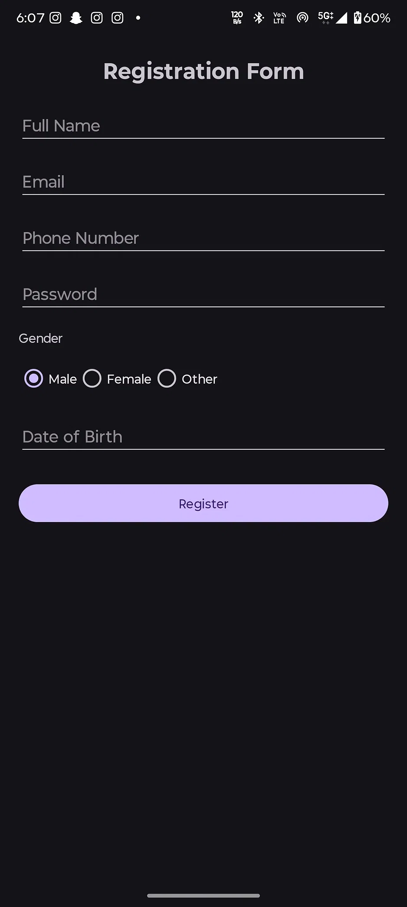

# Registration Form App

## Project Overview
A simple Android registration form UI developed using Kotlin and XML for the Veda Technology Android Development Track (Day 4).

## Technologies Used
- Kotlin
- XML Layouts
- Android Studio

## Features
- Name, Email, Phone, and Password input fields
- Gender selection using RadioGroup
- Date of Birth selection using DatePicker
- Register button

## How to Run
1. Clone the repository.
2. Open in Android Studio.
3. Sync Gradle.
4. Run the app.

## Outcome
The application successfully displays a multi-field registration form with all required components.

## Screenshot

